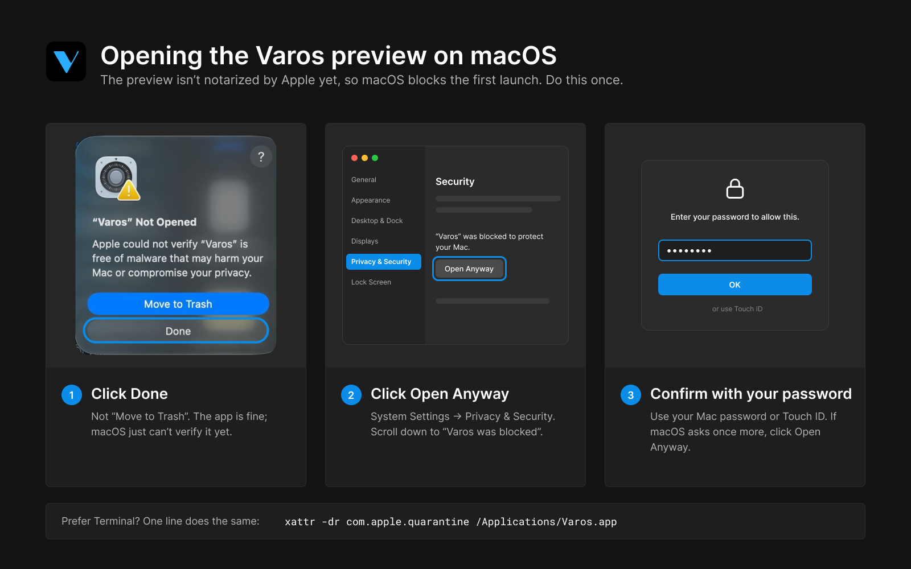
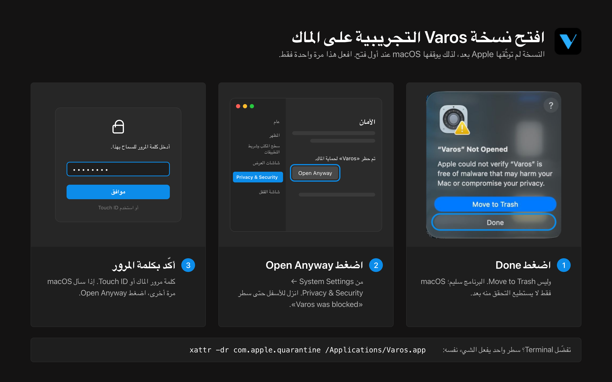

<p align="center">
  
</p>

<h1 align="center">Varos</h1>

<p align="center">
  <b>A free, open-source vector editor, Arabic and right-to-left first, written in Rust.</b>
</p>

## Try the preview

**Varos 0.1 Preview is a pre-alpha for invited designers.** Features are missing and things are
broken. Use copies of important files, save often, and keep your originals outside Varos.
Read [Known issues](KNOWN_ISSUES.md) before trying it.

### Install on macOS

- **macOS 11 (Big Sur) or newer, Apple Silicon only** (M-series chip). **Intel Macs will not run
  this download.** Check your chip in Apple menu → About This Mac.
- Open the [GitHub Releases page](https://github.com/thisisgomaa/varos/releases), choose
  **0.1 Preview**, and download **`Varos-0.1-preview.1-arm64.zip`** from Assets. Preview releases
  may not appear under GitHub's “Latest” release link.
- Before opening it, check the ZIP's SHA-256 against the checksum published with that release.
  In Terminal, from the folder containing the ZIP, run:

  ```sh
  shasum -a 256 Varos-0.1-preview.1-arm64.zip
  ```

  The entire 64-character hash must match. If the checksum is missing or differs, stop and report
  it to the maintainers through [GitHub Issues](https://github.com/thisisgomaa/varos/issues).
- Unzip the download and drag **Varos.app** to **Applications**.
- **First open:** the preview is ad-hoc signed, not notarized, so macOS says it cannot verify
  the developer. **Click Done, not Move to Trash.** Then open **System Settings → Privacy &
  Security**, scroll down to *"Varos" was blocked to protect your Mac* and click **Open Anyway**;
  confirm with your password. This happens once. (On macOS 11–12 the switch is under
  **System Preferences → Security & Privacy → General**.)

  

  Prefer Terminal? One line does the same: `xattr -dr com.apple.quarantine /Applications/Varos.app`

### Settings, saves and feedback

Settings and workspace layout normally live in `~/Library/Application Support/Varos/ui.json`.
In Finder, choose **Go → Go to Folder** and enter `~/Library/Application Support/Varos/` to find
that folder. Varos does not automatically migrate settings from VectorCraft.

Data Recovery is enabled by default, making separate recovery copies every two minutes in
`~/Library/Application Support/Varos/Data Recovery/`. Change it in **Preferences → File Handling
→ Data Recovery**. After an abnormal exit, **Recover Documents → Restore** opens available
copies unsaved; save them to keep them. Recovery is not a replacement for Save or backups; see
[its limits](KNOWN_ISSUES.md#files).

**There is no auto-update and no telemetry.** Download later previews manually from Releases.
Report problems through [GitHub Issues](https://github.com/thisisgomaa/varos/issues/new/choose),
after checking [Known issues](KNOWN_ISSUES.md). Reports in English or Arabic are welcome. Include
what you did, what you expected, what happened, the version from **Help › About**, and your macOS
version and Mac chip. A small sample file or screenshot helps; remove private content first.
For security problems, use [private vulnerability reporting](SECURITY.md).

<div dir="rtl" lang="ar">

<h3>جرّب النسخة التجريبية</h3>

<p><b>Varos 0.1 Preview نسخة مبكرة قبل ألفا للمصممين المدعوين.</b>
بعض الأدوات غير مكتملة وبعض الوظائف لا تعمل كما ينبغي. جرّبها على نسخ من ملفاتك المهمة،
واحتفظ بالأصول واحفظ عملك بانتظام. راجع <a href="KNOWN_ISSUES.md">المشكلات المعروفة</a> أولًا.</p>

<p>تحتاج إلى <b>macOS 11 أو أحدث وجهاز بمعالج Apple Silicon من سلسلة M</b>؛
لن تعمل هذه النسخة على أجهزة Intel.
نزّل <bdi>Varos-0.1-preview.1-arm64.zip</bdi> من
<a href="https://github.com/thisisgomaa/varos/releases">إصدارات GitHub</a>،
وقارن قيمة SHA-256 بالقيمة المنشورة مع الإصدار باستخدام الأمر أعلاه. إذا اختلفت القيمة
أو لم تجدها، فلا تفتح الملف وأبلغ القائمين على المشروع.</p>

<p>فك الضغط وانقل Varos.app إلى مجلد التطبيقات. النسخة موقّعة توقيعًا محليًا ولم توثّقها Apple،
لذلك سيقول macOS إنه لا يستطيع التحقق من المطوّر. <b>اضغط Done، وليس Move to Trash.</b>
ثم افتح «إعدادات النظام ← الخصوصية والأمان»، وانزل حتى سطر «تم حظر Varos» واضغط
<b>Open Anyway</b> (فتح على أي حال) وأكّد بكلمة المرور. يحدث هذا مرة واحدة فقط؛ الصورة التالية تشرح الخطوات.
في macOS 11 و12، الخيار في «تفضيلات النظام ← الأمن والخصوصية ← عام».
أو من Terminal بسطر واحد: <bdi><code>xattr -dr com.apple.quarantine /Applications/Varos.app</code></bdi></p>



<p>تُحفظ الإعدادات عادةً في <bdi><code>~/Library/Application Support/Varos/ui.json</code></bdi>،
ونسخ الاسترداد في مجلد <bdi>Data Recovery</bdi> بجواره. ينشئ التطبيق نسخة استرداد كل دقيقتين
افتراضيًا؛ يمكنك تعديل ذلك من «التفضيلات ← معالجة الملفات ← استرداد البيانات».
بعد توقف غير متوقع، اختر «استعادة» في نافذة استرداد المستندات إن ظهرت، ثم احفظ المستندات.
قد تضيع التغييرات التي تلت آخر نسخة؛ لا تعتمد على الاسترداد وحده.</p>

<p><b>لا يوجد تحديث تلقائي ولا جمع لبيانات الاستخدام.</b> نزّل التحديثات يدويًا.
أبلغ عن المشكلات بالعربية أو الإنجليزية عبر
<a href="https://github.com/thisisgomaa/varos/issues/new/choose">GitHub Issues</a>،
مع إصدار Varos من «مساعدة ← حول»، وإصدار macOS ونوع المعالج وخطوات المشكلة والنتيجة المتوقعة
والفعلية. يمكنك إرفاق ملف أو صورة بعد إزالة المحتوى الخاص.
للثغرات الأمنية، استخدم <a href="SECURITY.md">الإبلاغ الخاص</a>.</p>

</div>

## The name

**Varos** = **V**ector · **A**rabic · **R**TL · **O**pen **S**ource: a vector editor, Arabic first,
built for right-to-left scripts, and open source. The name was decided on 2026-06-21 and is
pronounced "VAH-ros" («فاروس»).

## Why Varos

Where Varos is going, and how to help: [ROADMAP.md](ROADMAP.md).


- **Arabic and RTL first.** Arabic type is the starting point, not an afterthought: kashida
  (tatweel) justification with Off / Auto / Force and a strength setting, Arabic font discovery,
  harakat colouring that keeps letters joined, paragraph direction and Arabic digit options.
- **Free and open.** MIT OR Apache-2.0, like the code it is built on. No account, no subscription.
- **AI-native.** People and agents work on the same open file. Any agent running as the same user
  can read, edit and save through the MCP bridge (`vectorcraft-cli mcp` attaches to the Varos that
  is open), its edits are recorded in the history with who made them, and they appear on the canvas
  in orange while a person's selection stays azure. Undo is the safety net; there are no approval
  or Keychain prompts.
- **Later: a community add-on library.** The WebAssembly plug-in API inherited from VectorCraft is
  the base; a shared, free library of add-ons is a goal, not something that exists yet.

## Status

Preview summary, 2026-11-05. The full truth table, with evidence for every row, is
[docs/varos/STATE.md](docs/varos/STATE.md); the ordered work list is
[docs/varos/BACKLOG.md](docs/varos/BACKLOG.md).

- **Platform:** the preview download is **macOS 11+, Apple Silicon only**. Other targets remain
  in the source tree; they are not supported Varos releases.
- **Available to test:** the VectorCraft editor underneath (drawing and path tools,
  Pathfinder, type with shaping and bidirectional layout, effects, SVG / PDF / `.ai` and many other
  formats; tour in [docs/UPSTREAM_README.md](docs/UPSTREAM_README.md)), shown as Varos: name, app
  icon, `.varos` as the default save extension (`.vectorcraft` and `.drawcraft` still open), and
  native format version 5 with independent **Pages** (upstream is at version 4).
- **Accepted UI foundation:** shared typography, controls and surfaces (warm-dark tokens,
  3 px / 8 px corners, no shadows), panel footer/content sizing and full-height side docks.
- **Built, with native validation still pending** (*provisional* in STATE): kashida Off / Auto /
  Force, Arabic Type Essentials and the Arabic font menu; Pages; medium UI font fallback;
  157 Varos icon overrides and native cursors; the clean Home screen; the unified **panel workspace**
  (groups, docking at four edges, floating, three presentations; Tools and Control as special bars);
  colour-picker eyedropper behavior; modeless Preferences; document-tab reordering; and the agent
  layer (`crates/varos-agents`). These are available for testing, not guarantees of reliability.
- **“Soon” means unavailable:** marked items are inert placeholders, including the in-app AI chat
  and image-generation controls. The existing MCP bridge is separate. There is no delivery date.
- **Performance:** rendering is still VectorCraft's CPU renderer. Measured on 2026-10-17 (release
  build, 4 render threads, 1920x1080), frame time grows with visible paths: 1k = 3.6 ms,
  5k = 16 ms, 20k = 64 ms. Large documents can be slow; a tile cache is planned, and GPU use
  remains undecided.
- **Validation:** the UI foundation and side-dock sizing have native acceptance recorded in STATE;
  other preview areas remain provisional. Local checks and their dates are linked there.
  GitHub CI has never run on this project; local tests are not a full native acceptance test.

## Build and run

Rust 1.95 or newer (`rust-version` in `Cargo.toml`) on macOS.

> **Why `vectorcraft` in the commands?** Varos is built on VectorCraft, and the internal crate and
> binary names stay upstream's (`vectorcraft`, `vectorcraft-cli`) so its updates keep merging cleanly.
> Everything you see — the app, its window, menus, bundle (`com.varos.app`), data folder and `.varos`
> files — is Varos. The sample files in `examples/` come from VectorCraft; Varos opens them as is.

```sh
git clone https://github.com/thisisgomaa/varos
cd varos

cargo run --release -p vectorcraft                          # the Varos app
cargo run --release -p vectorcraft -- path/to/file.varos    # open a file
cargo run --release -p vectorcraft -- --control 7979        # + JSON control channel
cargo run --release -p vectorcraft-cli -- mcp               # MCP bridge: attaches to the open Varos
cargo run --release -p vectorcraft-cli -- mcp --headless    # MCP without the app
cargo run --release -p vectorcraft-cli -- run --in examples/ribbons.vectorcraft --export out.pdf   # headless batch
cargo xtask bundle                                          # dist/Varos.app (macOS)
CARGO_BUILD_JOBS=4 cargo xtask ci                            # all local gates; see CONTRIBUTING.md
```


Register the bridge with an agent, for example Claude Code:

```sh
claude mcp add varos -- /path/to/vectorcraft-cli mcp
```

Details: [docs/mcp.md](docs/mcp.md) and [docs/control-protocol.md](docs/control-protocol.md).
Optional CJK fonts, graphics-processor choice and other build options are explained in
[docs/development.md](docs/development.md). The signed macOS release path is
`packaging/macos/package.sh`.

The `crates/text-arabic` crate takes Varos's kashida policy from the `varos-text` crate of this
repository's earlier engine, vendored in `crates/varos-text/` and used as a path-only dependency
with default features disabled. Building it does not fetch the legacy repository.

## Built on VectorCraft

Varos is based on VectorCraft by the ArtCraft team
([storytold/vectorcraft](https://github.com/storytold/vectorcraft)), and is licensed the same way:
[MIT](LICENSE-MIT) OR [Apache-2.0](LICENSE-APACHE), at your option. Upstream's copyright and
required notices are kept in [NOTICE](NOTICE); every bundled asset is listed with its author,
source and licence in [ASSETS.md](ASSETS.md). Varos is not an ArtCraft product and uses none of
the ArtCraft marks ([docs/brand/LICENSE-brand.txt](docs/brand/LICENSE-brand.txt)).

What Varos adds lives mostly in its own modules (`crates/ui-egui/src/varos/`,
`crates/text-arabic/`, `crates/varos-agents/`) with small, marked hook lines in upstream files;
the rules are in [docs/varos/FORK.md](docs/varos/FORK.md). Upstream VectorCraft's own README is
kept for reference in [docs/UPSTREAM_README.md](docs/UPSTREAM_README.md).

**The legacy engine.** Varos's first engine, a from-scratch Rust/wgpu editor with 806 commits,
lives on branch `legacy-engine` / tag `legacy-engine-2026-10-19`. Why Varos moved to VectorCraft
is told in [docs/varos/HISTORY.md](docs/varos/HISTORY.md).

## Documentation

| Document | What it holds |
|---|---|
| [KNOWN_ISSUES.md](KNOWN_ISSUES.md) | Preview limitations and workarounds |
| [CONTRIBUTING.md](CONTRIBUTING.md) | Contributing, local checks and asset rules |
| [SECURITY.md](SECURITY.md) | Private security reporting and bridge trust model |
| [docs/varos/STATE.md](docs/varos/STATE.md) | The one truth table: what exists, its status and evidence |
| [docs/varos/BACKLOG.md](docs/varos/BACKLOG.md) | Ordered work, each item with its acceptance line |
| [docs/varos/FORK.md](docs/varos/FORK.md) | How Varos relates to upstream: rules, merges, licences |
| [docs/varos/HISTORY.md](docs/varos/HISTORY.md) | The project story, in facts |
| [docs/varos/WORKSHOP.md](docs/varos/WORKSHOP.md) | How work is planned, built, gated and reviewed |
| [docs/varos/PAGES.md](docs/varos/PAGES.md) | Project pages (native format v5) |
| [docs/varos/SHELL_SUMMARY_AR.md](docs/varos/SHELL_SUMMARY_AR.md) | Shell design of record (Arabic) |
| [docs/varos/PANEL_IMPLEMENTATION_PLAN.md](docs/varos/PANEL_IMPLEMENTATION_PLAN.md) | Panel workspace plan and approval record |
| [docs/varos/STABILITY_2026-11-01.md](docs/varos/STABILITY_2026-11-01.md) | Stability work and verification record |
| [docs/varos/AI_PANEL_PLAN.md](docs/varos/AI_PANEL_PLAN.md) | Planned in-app AI panel |
| [docs/varos/lanes/](docs/varos/lanes/) | Lane reports and gate logs (evidence, not state) |
| [AGENTS.md](AGENTS.md) | Rules for agents and contributors |
| [docs/UPSTREAM_README.md](docs/UPSTREAM_README.md) | Upstream VectorCraft README (reference) |

## Licence

MIT OR Apache-2.0, at your option ([LICENSE-MIT](LICENSE-MIT), [LICENSE-APACHE](LICENSE-APACHE)).
Required notices: [NOTICE](NOTICE). Assets and their licences: [ASSETS.md](ASSETS.md).

<p align="center" dir="rtl">
  <b>Varos وقفٌ للعالم كله.</b><br>
  الوقف في تراثنا أن يُحبَس أصلُ الشيء، فلا يُباع ولا يُوهَب ولا يُورَث، وتبقى منفعته مفتوحةً لكل الناس على الدوام،
  كبئرٍ يشرب منها كل عابر، أو مكتبةٍ يقرأ فيها كل طالب. وبهذه الروح وُقف Varos: مجانيٌّ ومفتوح المصدر،
  منفعته لكل مصمم في كل مكان، بلا اشتراك ولا حساب.
</p>

<p align="center">
  <b>Varos is a waqf for the whole world.</b><br>
  In our tradition, a <i>waqf</i> (endowment) holds an asset in perpetuity: it cannot be sold, given away or inherited,
  and its benefit stays open to everyone, forever — like a well any passer-by may drink from, or a library any
  student may read in. Varos is endowed in that spirit: free and open source, for every designer everywhere,
  with no subscription and no account.
</p>
