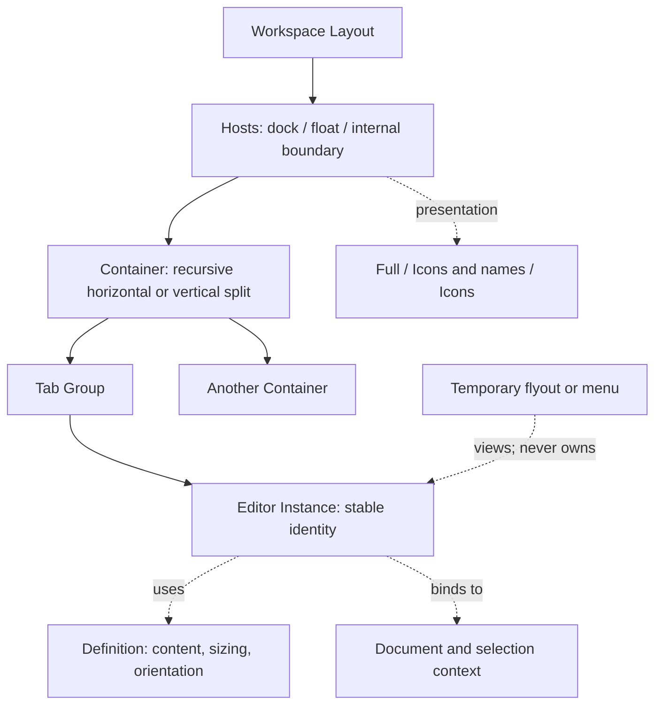

# دراسة أساس نظام البانلات في Varos

التاريخ: 2026-11-01. الحالة الأحدث: **التصور التفاعلي معتمد؛ خطة التنفيذ للمناقشة؛ لا تنفيذ للتطبيق**.

تحديث لاحق للدراسة: اعتمد المستخدم معاينة `varos-panel-icon-review.html` بعد تكبير الرموز.
راجع [خطة التنفيذ وسجل الاعتماد](PANEL_IMPLEMENTATION_PLAN.md) للمقاسات والبصمة والشرائح.
فقرات الدراسة التالية تسجل مرحلة ما قبل هذا الاعتماد؛ عبارات انتظار مراجعة التصور أصبحت
تاريخية. هذا لا يغلق إصلاح Color ولا يثبت سلوك النسخة Native.

تحديث صاحب المشروع بعد الدراسة: ترتيب Properties ثابت حسب السياق، والعائمة تتحرك داخل
مساحة العمل كلها، وX يخفي الكتلة كاملة وتُعاد من قائمة Window العلوية. المطلوب الآن تصور
المجموعات والحالات الثلاث قبل أي تنفيذ. هذا الاعتماد لا يعني قبول باقي التفاصيل أو إصلاح Color.

هذه الدراسة تجمع طلب المستخدم الأخير، ومراجعة المصدر الحالي، وفاروس القديم، والاتفاقات
السابقة، ووثائق Blender العامة. لا تغييرات في التطبيق أو بناء أو اختبار تشغيل ضمن هذه المرحلة.
نسخة قصّ Color ‏0.19.1 ما زالت تنتظر قبول المستخدم؛ الحديث عن المعمارية لا يُعد قبولًا لها.

## 1. الخلاصة الهندسية

المشكلة الأساسية هي غياب عقد واحد مكتمل للهوية والمكان والعرض والمقاس والتفاعل. لدينا شجرة
تقسيم ومجموعات تابات ومعاملات نقل قابلة للإلغاء بالفعل، لكن العائمة وعمود الأيقونات والأدوات
تستخدم تمثيلات ومسارات مختلفة. لذلك يمكن أن تتحرك قطعة، ولا تستطيع الانضمام لقطعة أخرى،
أو يتغير مكانها وبنيتها عند الطي. تعديل الأسهم وحده لا يعالج ذلك.

التوصية: **توحيد نموذج التركيب تدريجيًا فوق الأجزاء الصالحة الحالية، مع نظام مكونات بصري
وسلوكي مشترك**. لا توجد أدلة تبرر إعادة كتابة التطبيق كله أو استبدال محرك المستندات.
توحيد الشكل وحده غير كافٍ؛ وتوحيد التخزين وحده لا يكفي من دون قواعد واضحة للمستخدم.

## 2. ما تأكد من المصدر، وما لم يتأكد

الملاحظات التالية تخص شجرة العمل وقت الدراسة؛ ليست شهادة على النسخة المثبتة أو قبولًا بصريًا.

| المشكلة | الحقيقة الحالية | الاستنتاج وحدوده |
|---|---|---|
| مجموعات عائمة لا تتركب ككتلة واحدة | `Node` يدعم التقسيم، لكن `Float` يحمل `PanelBox` واحدة | فجوة في النموذج: لا يحمل الجذر العائم شجرة مجموعات كاملة [S1] |
| اختلاف التركيب حسب موضع المسك | سحب رأس العائمة يتجاوز أهداف التثبيت العامة؛ Tools لها مسار يسار/عائم خاص | ينبغي أن تتفق عمليات النقل مهما اختلف مقبض البداية، مع اختلاف العنصر المنقول [S2] |
| الطي يفقد ترتيب الكتلة | توسيع عمود عائم متعدد المجموعات ينشئ عوائم منفصلة بإزاحة قطرية | تحويل العرض يعيد بناء التركيب بدل الاحتفاظ به [S3] |
| الرجوع لليمين عند الإغلاق | إغلاق العائمة يعيدها إلى موطن مسجل؛ الموطن مؤقت وغير محفوظ | هذا سلوك مكتوب، وفيه تعارض مع الطلب الأحدث، لا مجرد خطأ رسم [S3] |
| Control يأخذ ارتفاعًا كبيرًا | ارتفاع خاص `ROW + 64` يساوي 100 نقطة منطقية للورقة التي تحتوي Control وحده | المقاس ليس نتيجة قياس المحتوى، وهو سبب مؤكد للفراغ المحجوز [S1] |
| Color مقصوصة | حساب مستقل خارج نظام الحاويات؛ تعديل 0.19.1 يعالج تغذية ارتفاع Area قديم إلى ScrollArea | آلية المصدر معروفة؛ نجاح العلاج على شاشة المستخدم لم يُعتمد [S4] |
| X والأسهم كبيرة والتاب منفصلة بصريًا | رمز رأس العائمة 16×16 ومساحة الضغط نفسها؛ التاب النشط كبسولة مستقلة | نحتاج فصل مقاس الرمز عن مساحة الضغط، وهيكل تاب متصل بالمحتوى [S5] |
| النقاط بجوار أقسام Properties مربكة | النقاط مرسومة كـellipsis لكنها مقبض سحب لإعادة الترتيب، واسمها المتاح «Move section» | إشارة بصرية لا تعبّر عن وظيفتها. إزالة الترتيب قرار منتج مقترح، لا شرط معماري [S6] |
| السحب غير سلس | الشكوى مؤكدة من المستخدم؛ المصدر يحتوي حركات للفتح والإفلات | لا يكفي ذلك لنسب التقطيع إلى الحركة أو GPU؛ يحتاج قياسًا لاحقًا على النسخة المعنية |

الجرد الحالي: 3 بانلات في `DockTab` و40 في `ICON_PANELS`، أي **43 بانل مسجلة**؛
Tools وControl وBoard لها مسارات خاصة. رقم 42 في تسليم أكتوبر جرد تاريخي [S7].

## 3. ما نتعلمه من فاروس القديم ومن التجارب السابقة

فاروس القديم يحتوي بالفعل فصلًا بين حجم الرسم ومساحة الضغط: مثال تاريخي زر إغلاق تاب
بمنطقة 18 نقطة ورمز 12 نقطة، وأيقونات 13/16/18 مع أهداف ضغط مستقلة. لديه أيضًا خط أرقام
ومقاسات حقول مشتركة. **هذه مبادئ قابلة لإعادة الاستخدام، وليست مقاسات جديدة معتمدة** [L1].

مكوّن الأرقام القديم يفصل الكتابة المؤقتة والتغيير المباشر والإقرار والإلغاء، ويحافظ على
دقة التراكم أثناء السحب بعيدًا عن تقريب النص المعروض. لكنه يترك بعض التراجع خطوة بخطوة
لمعالجات خاصة في Stroke وAppearance. نحتفظ بالعقد الجيد؛ لا ننقل هذا التشتت [L2].

تدقيق 24 سبتمبر القديم يسجل ثلاثة دروس: اختلاف الحد الأدنى والهوامش والتمرير يسبب القص؛
نسختان من نفس عنصر التحكم تتباعدان وظيفيًا؛ واختبار جسم بديل لا يثبت سلامة البانل الحقيقية.
هذه **دروس مؤرخة**، وليست قائمة عيوب حالية. مثلًا حفظ الشجرة والتحقق منها موجود الآن
في `boxtree.rs` القديم، فلا يصح تكرار تشخيص «الترتيب لا يُحفظ» من التقرير التاريخي [L3].

### سجل القرارات المتغيرة

| الموضوع | الاتفاق/التنفيذ السابق | اتجاه الدراسة الحالي |
|---|---|---|
| مقبض السحب | مقبض خفي، دون شريط عنوان دائم في اتفاق أكتوبر | طلب أحدث صريح: شريط داكن ظاهر، وسحب من تاب الاسم؛ الأحدث هو المرجع |
| ترتيب أقسام Properties | إعادة ترتيب محلية مسموحة | اعتمد المستخدم ترتيبًا ثابتًا حسب السياق؛ لا إعادة ترتيب محلية في الاتجاه الجديد |
| حدود العائمة | داخل المساحة المالكة | اعتمد المستخدم الحركة في مساحة العمل كلها؛ ارتباط المستند منفصل عن الموقع |
| القضبان الداخلية | على أي فاصل داخلي، أفقيًا أو رأسيًا، وفي أي عمق | مطلب سابق محفوظ في الأساس؛ لا نستبدله ضمنيًا بالحواف الأربع فقط |
| Board/Viewport | مساحة مستقلة قابلة للتركيب، وليست خلفية ثابتة | يظل النموذج قادرًا على تمثيلها؛ لا نضيف عدة مشاهد مستند تلقائيًا في أول شريحة |
| الإغلاق والطي | بعض تكليفات الإصلاح القديمة طلبت العودة للموطن | الطلب الأحدث يلغي العودة التلقائية؛ نفصل الإخفاء عن الطي والنقل |
| Color | نافذة تأكيد مؤقتة في تكليف قديم | المطلوب لوحة لون لا تمنع اللوحة الفنية؛ قوائمها الفرعية لا تفقد هويتها أو موضعها |
| الظلال | ظهرت في بعض مراجع HTML القديمة | اتجاه 28 أكتوبر الأحدث يحدد عوائم بلا ظل؛ لا نعيد الظل من مرجع أقدم |

المصدر: اتفاق أكتوبر واتجاه Shell الأحدث وتكليفات التنفيذ المؤرخة [H1–H3]. لا نعدل ملفات
الاتفاق أو HTML المعتمدة؛ هذا السجل يوضح ما استُبدل وما لا يزال يحتاج قرارًا.

## 4. ماذا نأخذ من Blender؟

وثائق Blender تفصل مناطق العمل القابلة للتقسيم والضم وتغيير الحجم، وتصف معاينة للعملية
وإمكانية إلغائها. يفيدنا ذلك في فصل بنية المساحة عن محتواها، وفي جعل إسقاط العنصر عملية
واضحة قبل الالتزام بها. [Blender Areas 5.0](https://docs.blender.org/manual/en/5.0/interface/window_system/areas.html)

وثائقه تفصل كذلك مناطق المحرر مثل الرأس والشريط الجانبي. نستفيد من فصل أدوار الرأس
والمحتوى؛ لا نفترض أن نظام العوائم والتابات المطلوب في Varos مطابق لنظام Blender.
[Blender Regions 4.0](https://docs.blender.org/manual/en/4.0/interface/window_system/regions.html)

الحقول العددية في Blender تدعم السحب والكتابة والإلغاء والوحدات وحدود القيم. ما يهمنا هو
اتساق التفاعل؛ تعديل مفاتيح Varos أو إضافة تعبيرات أو Drivers ليس جزءًا من الطلب.
[Blender Input Fields](https://docs.blender.org/manual/en/latest/interface/controls/buttons/fields.html)

## 5. مقارنة المسارات

| المسار | المكسب | التكلفة/الخطر | القرار المقترح |
|---|---|---|---|
| ترقيع كل تمثيل على حدة | أسرع تعديل منفرد | تحويلات كثيرة بين الحالات، واختلافات تستمر في الظهور | لا يصلح أساسًا طويل الأجل |
| نموذج تركيب واحد مع انتقال تدريجي | يحتفظ بالبانلات والمحرك، ويوحد النقل والطي والحفظ | يحتاج خطة ترحيل وعقودًا صريحة | **الموصى به** |
| إعادة كتابة أو مكتبة Docking بديلة | إمكانات جاهزة محتملة | ملاءمة غير مثبتة للقضبان الداخلية والحالات الثلاث وبيانات المستخدم | لا دليل يبرره الآن |

## 6. النموذج المقترح: الهوية، ثم التركيب، ثم مكان العرض

الأسماء التالية توضيحية؛ ليست أسماء ملفات أو API معتمدة.

**المحتوى:** تعريف موحد يصف الرسم والمقاسات والاتجاه والسياق. مثيل المحتوى له هوية ثابتة
وحالة عرض محلية؛ نقله لا يعيد إنشاءه ولا ينسخ المستند. Tools وControl وBoard أنواع محتوى
ضمن الأساس نفسه، مع اختلاف تخطيط الداخل، لا مع منع تركيب متاح لغيرها.

**التركيب:** مجموعة تابات لها عضو نشط. الحاوية تحمل مجموعة أو تقسيمًا متكررًا لمجموعات.
الجذر العائم والجذر المثبت يقبلان القواعد نفسها؛ لذا يمكن لكتلة عائمة أن تحتوي مجموعتين
جنبًا إلى جنب، أو فوق بعضهما، وتتحرك كاملة دون تفكيكها.

**المكان:** مضيف مثبت أو عائم أو مربوط بحافة/فاصل داخلي. الفاصل يُشار إليه بهوية مستقرة
واتجاه، لا بإحداثيات بكسل فقط. عند حذف الفاصل نحتاج قاعدة انتقال صريحة لأقرب موضع صالح.
القضيب طريقة عرض لنفس التركيب، وليس نسخة أخرى تملك البانلات نفسها.

**العرض:** كامل، أيقونة واسم، أيقونة فقط. تطبق الحالة على نطاق واضح هو المجموعة أو
الحاوية المستهدفة. تحفظ البنية والأبعاد الموسعة. العرض الجانبي المؤقت يرى نفس المثيل،
ولا ينقله أو يسجله كمالك ثانٍ.

**الظهور:** منفصل عن العرض والمكان. إخفاء حاوية يحتفظ ببنيتها. إخفاء تاب واحدة ينقلها
إلى موضع محفوظ غير ظاهر، مع مرجع عودة؛ المرجع بيانات تذكّر وليس ملكية ثانية.

التخزين المرجعي الوحيد هو شجرة التركيب وجذورها. سجل المثيلات يحفظ حالة المحتوى، ولا
يحفظ نسخة متنافسة من عضوية كل بانل. لكل مثيل مالك واحد دائمًا.

## 7. عقد العمليات والتفاعل

| فعل المستخدم | العملية المقصودة |
|---|---|
| سحب الشريط الداكن | نقل الكتلة التي يخصها الرأس كاملة |
| سحب تاب الاسم | إعادة ترتيب أو فصل هذه البانل أو ضمها لمجموعة |
| سحب الفراغ بجوار التابات | نقل المجموعة؛ لا يمتد إلى الأزرار والحقول |
| الإفلات وسط مجموعة | ضم كتـاب، بمعاينة تختلف عن التقسيم |
| الإفلات عند طرف مجموعة | تقسيم جانبي أو رأسي مع الاحتفاظ بالمجموعتين |
| الإفلات في مساحة حرة | وضع عائم، بحجم مفضل مناسب ومسكة مؤشر ثابتة |
| الطي/التوسيع | تغيير العرض في المكان نفسه، دون تحويل ملكية أو رجوع لليمين |
| الضغط على أيقونة | فتح محتواها مجاورًا مع بقاء الهيكل المختصر في مكانه |
| الإغلاق | إخفاء وحفظ الموضع؛ لا عودة ضمنية للموطن |
| Escape أو فقد التقاط المؤشر أثناء النقل | إلغاء المعاينة واستعادة ترتيب ما قبل الحركة |

اعتمد المستخدم أن X في رأس الكتلة يخفي الكتلة كلها، وأن إعادة الفتح تكون من قائمة Window
العلوية. التصور يعرض اختيار بانل من Window لاستعادة كتلتها المحفوظة وتنشيط البانل المختارة؛
تفاصيل عناصر القائمة تُراجع بصريًا. إغلاق تاب منفردة ليس زر X إضافيًا ضمن هذه المعاينة.

معاينة الإفلات لا تعدّل الشجرة. الالتزام يمر عبر عملية واحدة: تحقق → تطبيق على نسخة →
تنظيف البنية → تحقق صالح للتشغيل → استبدال الحالة. نحتفظ بالمعاملة الحالية الجيدة ونوسعها؛
لا نعتمد على `debug_assert` وحده لمنع حالة تالفة. التحديثات أثناء الرسم لا تنقل الملكية.

أولوية الإدخال: تحكم نشط/تحرير رقم، ثم مقبض مخصص، ثم منطقة رأس خالية. يبدأ السحب بعد
عتبة حركة حتى لا تتحول النقرة إلى نقل. الإلغاء يخص التفاعل النشط وحده. تغيير المستند أو
إغلاقه يحسم تحريرًا متعلقًا به قبل إعادة ربط الحقول، ولا ينقل تعديلًا لمستند آخر.

عمليات الترتيب أوامر UI مسماة قابلة للوصول من القائمة والكيبورد وقناة التحكم؛ تعديل
المحتوى يبقى عبر أوامر المحرك. إعادة ترتيب الواجهة لا تدخل في سجل Undo الخاص بالرسم.

## 8. نظام التصميم: نفس القواعد لكل بانل

### المستويات الثلاثة

1. **شريط التحكم والمسْك:** داكن ورفيع، رموز صغيرة بصريًا، ومساحات ضغط مريحة مستقلة عنها.
2. **صف التابات:** تابات متجاورة؛ سطح النشط متصل بالمحتوى. أدوات المجموعة عند الطرف،
   ولا نكرر سهم الطي داخل كل تاب أو نستعمله أيضًا لمعنى «تابات مخفية».
3. **المحتوى:** شبكة محاذاة ثابتة للأسماء والقيم، أقسام وفواصل وهوامش مشتركة، وتمرير داخل الجسم.

يتكرر الأساس نفسه في جميع البانلات. عندما تكون مجموعات داخل حاوية واحدة، نعرض مستويات
التحكم اللازمة فقط، ونبيّن نطاق كل مقبض؛ لا نضيف شريط عنوان مكررًا لكل مستوى شجرة تلقائيًا.
تفصيل الرؤوس المثبتة والمتداخلة يحتاج لوحة حالات بصرية بعد الاتفاق المعماري.

| عائلة المقاسات المشتركة | ما يُفصل ويُقاس مستقلًا |
|---|---|
| الرموز | رمز البانل، رمز التحكم، سمك الرسم، مساحة الضغط |
| الرأس | ارتفاع المسك، ارتفاع التابات، مسافات الأطراف والفواصل |
| النص | اسم البانل، عنوان القسم، label، قيمة رقمية بأرقام ثابتة العرض |
| الحقول | ارتفاع الحقل، عرض القيمة، مكان الوحدة، خط الأساس، حالة الخطأ |
| الجسم | هوامش المحتوى، فجوة صف، فجوة قسم، سمك الفاصل |
| الحالات | عادي، hover، تركيز كيبورد، نشط، معطل، قيمة مختلطة، قيمة غير صالحة |

نقيس بوحدات منطقية ثم نراجع على مقياس شاشة المستخدم. لا نستنتج المقاسات من بكسلات
قصاصات غير معروفة التحجيم. نستخدم رموز Varos الأصلية وألوانه وخطوطه الحالية، دون نسخ أصول
المراجع. المقاس النهائي يأتي من معاينة مشتركة قبل التعميم، وليس رقمًا اخترعه كل ملف.

**Properties — معتمد:** ترتيب ثابت للأقسام المناسبة لكل سياق: المستند، العنصر، النص…
مع بقاء فتح/طي الأقسام. «ثابت» لا يعني إظهار أقسام لا تناسب التحديد. عند التنفيذ تزال
مقابض الترتيب الملتبسة؛ وأي قائمة خيارات حقيقية تظهر فقط حين يكون لها عمل واضح.
إعدادات الترتيب القديمة تحفظ في نسخة الانتقال ولا تمحى بلا سياسة معلنة.

## 9. الأرقام: نحافظ على السحب ونوحد العقد

هذا جزء أساسي من النظام، لا تفصيلة تجميلية. النسخة الحالية تملك بالفعل parsing للوحدات
وقيمًا مختلطة وسحبًا من الـlabel مرتبطًا بـUndo المستند. القديم يسحب من جسم الحقل أيضًا؛
الموقعان ليسا السلوك نفسه. **نحتفظ بالسحب الحالي، ونحسم توسيعه لجسم الحقل في معاينة مستقلة** [S8، L2].

المقترح مكوّن واحد بعقد صريح: هوية مستند + هدف + خاصية + وحدة + دقة + حدود + خطوة،
بدل استنتاج الـlabel السابق وموقعه لربطه بالحقل. لا نفقد parser الوحدات الحالي باستبداله
بـparser الأرقام المحدود في النسخة القديمة.

- النقر والكتابة والسهام والسحب تتعامل مع القيمة نفسها؛ التقريب للعرض لا يراكم فقدًا في الدقة.
- Gesture واحدة: Begin → Preview → Commit، وEscape يعيد قيمة بدايتها. لا تعديل يعني لا Undo جديد.
- لكل Gesture مالك؛ فتح Picker أو تعديل صادر من اللوحة/وكيل لا يختلط بتراجع حقل آخر.
- القيم المختلطة والمعطلة وغير الصالحة حالات منفصلة، وليس كلها صفرًا أو خانة فارغة.
- نحافظ مبدئيًا على مفاتيح Varos الحالية: Shift للتكبير وCtrl/Cmd للدقة؛ لا نستورد مفاتيح برنامج آخر ضمنيًا.
- أولوية Escape للمحرر/القائمة الفرعية النشطة، ثم التفاعل الخارجي؛ لا يغلق السلسلة كلها دفعة واحدة.

تعديل فصل تراجع اختصارات الكيبورد الموجود سابقًا في شجرة العمل مؤجل، وغير مشمول بنسخة
قصّ Color؛ لا نقدمه كدليل أن هذا العقد الكامل مطبق أو مختبر.

## 10. المقاس والتمرير والسلاسة

كل محتوى يصف حدًا أدنى، وحجمًا مفضلًا، وقابلية التمدد، واتجاهًا، وسياسة overflow.
الحاوية تقيس المتاح ثم توزع المقاسات؛ لا يتخذ اسم البانل قرارًا خاصًا داخل شجرة التقسيم.
هذا يعالج سبب تكرار استثناءات Control وColor بدل ضبط أرقامهما كل مرة.

يبقى الرأس ظاهرًا، ويتم التمرير في الجسم فقط. عند ضيق النافذة تُستخدم سياسة معلنة
للمحتوى: صفوف بديلة أو تمرير مناسب، وليس قصًا صامتًا أو طيًا يفاجئ المستخدم. تغيير الحجم
لا يوسّع الحد الأدنى من بيانات إطار سابق في حلقة Area/ScrollArea. النوافذ المؤقتة تختار
جهة ومساحة صالحة قبل الرسم، وتظل أدواتها قابلة للوصول.

مستطيلات الرسم والضغط وأهداف الإسقاط تأتي من نتيجة ترتيب واحدة بإصدار معروف. أثناء السحب
تتبع القطعة المؤشر مباشرة؛ لا easing يؤخرها. لا أعد بمعدل إطارات أو أنسب التقطيع لسبب
معين قبل القياس الفعلي لاحقًا. تصميم رأس أصغر ليس برهانًا على حل تأخر الحركة.

## 11. الحفظ والانتقال والتوسع

نبدأ من مخطط الإعدادات الحالي v7، مع نسخة احتياطية وقراءة تحقق قبل كتابة الإصدار الجديد.
نحافظ على الهويات والتقسيمات والمقاسات والتاب النشط والمكان وحالات العرض، ونسترد المدخلات
السليمة بصورة مستقلة. النسخة غير المعروفة لا تُستبدل بترتيب افتراضي ثم تُكتب فوق الأصل.

المقاس الفعلي للإطار وhover ومعاينة السحب بيانات مؤقتة لا تدخل ملف مساحة العمل. المرجع
المنطقي للموقع يُحفظ؛ الإحداثيات تُضبط عند اختلاف الشاشة كي يظل الرأس قابلًا للوصول.
نحدد حدودًا لعمق الشجرة وعدد العقد، ونرفض القيم غير المنتهية والملكية المكررة والحلقات.

الانتقال تدريجي عبر محولات محدودة، مع مصدر واحد يملك الحالة في كل مرحلة؛ لا تشغيل نموذجين
يكتبان مواقع البانلات بالتوازي. لكل بانل جديدة تعريف محتوى/مقاسات/أوامر في السجل، بدل إضافة
فروع خاصة في السحب والحفظ والرؤوس. لا يتطلب ذلك فصلًا جديدًا للمحرك أو نسخ حالة المستند.

**حدود النطاق:** لا نضيف نوافذ نظام تشغيل متعددة، أو خدمة Libraries، أو Generate Vectors،
أو أدوات جديدة من الصور. الأساس يستوعب التطور دون الادعاء أننا سننفذ كل احتمال الآن.

## 12. مخاطر يجب أن يغطيها الاتفاق ثم التنفيذ

| الحالة | القاعدة المطلوبة |
|---|---|
| طي حاوية داخلها تقسيمات ثم توسيعها | نفس الهوية والبنية والترتيب والأبعاد الموسعة |
| تغيير الشاشة/التحجيم/اتجاه النص | رؤوس وأهداف ضغط قابلة للوصول، وخطوط أساس محاذاة، لا قص |
| تبويب مخفي أو اسم طويل أو عمود طويل | overflow واضح، لا سهم له معنيان، والعضو النشط يمكن الوصول إليه |
| سحب فوق رقم أو فاصل أو قائمة مفتوحة | مالك إدخال واحد، لا تحريك بانل أثناء تعديل الرقم |
| إلغاء السحب أو تبديل workspace أثناءه | لا جزء مفقود ولا نسخة مكررة؛ المعاملة تُلغى |
| تغيير التحديد أو المستند أثناء تحرير قيمة | لا كتابة إلى الهدف الجديد بالخطأ ولا تراجع يلغي عملًا آخر |
| إخفاء المجموعة وإعادة فتحها بعد إعادة التشغيل | استعادة مقصودة، لا اعتماد على «موطن» مؤقت |
| ترتيب محفوظ قديم/تالف جزئيًا/من إصدار أحدث | حفظ الأصل، واسترداد مفهوم دون محو صامت |

هذه حالات قبول مستقبلية، ولم تُنفَّذ اختبارات لها في هذه الدراسة. التحقق لاحقًا يشمل
المكونات الحقيقية مع حدود المقاس، وسلوك المستخدم في النسخة المحددة؛ الصور تثبت الشكل فقط.

## 13. القرارات والمراحل التالية

**اعتماد المستخدم بعد الدراسة:** ترتيب Properties ثابت حسب السياق؛ العائمة تتحرك داخل
مساحة العمل كلها؛ وX يخفي الكتلة كاملة، وإعادتها من Window في الأعلى. الحالة الحالية هي
مراجعة تصور المجموعات والحالات الثلاث. لا بدء للتنفيذ أو بناء التطبيق من هذا الاعتماد وحده.

المعاينة المنفصلة تستخدم نفس مجموعتي Properties/Layers وSwatches/Color في الحالات الثلاث،
ومثال ترتيب أفقي/رأسي للكتلة وإخفائها وإعادتها. قيم Rectangle المعروضة أمثلة توضيحية؛
التابات وWindow والتحريك في المعاينة سلوك محلي توضيحي، لا إثبات لتنفيذ Native أو قبول له.

القضبان الداخلية محفوظة من الاتفاق السابق وليست سؤالًا لإسقاطها؛ نحدد فقط متى نظهرها
في شرائح التجربة. أي أبعاد رقمية أو أسماء API هنا ليست قرارًا نهائيًا.

| المرحلة | الناتج وحدّ التوقف |
|---|---|
| الآن | القرارات الثلاث معتمدة؛ مراجعة تصور المجموعات والحالات الثلاث؛ لا تنفيذ تلقائي بعدها |
| المعاينة الحالية | رأس وأرقام وأقسام وحالات ثلاث، وتركيب أفقي/رأسي وإخفاء/استرجاع؛ تصوّر مقترح |
| بعد اعتماد الشكل | شريحة ببانلين موجودتين فقط: ضم/فصل/طي/إلغاء/إعادة فتح |
| بعد قبول المستخدم | تركيب مجموعتين ونقل الكتلة والحواف والفواصل الداخلية، كل حالة منفردة |
| بعدها | إدخال Control ثم Tools ثم Color في العقد المشترك، كل محتوى بحدود قياسه وتفاعله؛ هذا غير إصلاح القص المنفصل |
| قبل التعميم | اعتماد الحفظ وترحيل ترتيب المستخدم، ثم نقل بقية البانلات تدريجيًا |
| التسليم | فحوص الكود المناسبة وCI قبل أي commit، والحزمة النهائية وتجربة المستخدم؛ لا Release لكل تفصيلة |

P0 (قصّ Color) يظل بندًا منفصلًا ينتظر المستخدم. بحث المعمارية لا يتوقف عليه، لكن
التنفيذ التالي لا يبدأ قبل قبول P0 **واعتماد المعمارية**. قائمة التنفيذ المفصلة في
[ترتيب المراجعة](PANEL_SYSTEM_REVIEW_QUEUE.md) تُقرأ تحت هذا الشرط.

## 14. دليل المصادر المحلية

الإشارات التالية مواقع قراءة في شجرة العمل بتاريخ الدراسة؛ أرقام الأسطر قد تتحرك بعد التنفيذ.

- **S1:** `crates/ui-egui/src/varos/shell/tree.rs:67,103,120,683`؛ `floats.rs:46`؛ `persist.rs:41`.
- **S2:** `crates/ui-egui/src/varos/shell/drag.rs:60,264,469,472,666,703,727`.
- **S3:** `crates/ui-egui/src/varos/shell/persist.rs:82,502,653,750,773,802,925`؛ `floats.rs:78,346`؛ `strip.rs:41`.
- **S4:** `crates/ui-egui/src/varos/picker/mod.rs:877,934`؛ مرشح 0.19.1 وإيصالاته في `dist/color-clip-2026-11-01/`.
- **S5:** `crates/ui-egui/src/varos/shell/floats.rs:23,163,192`؛ `boxes.rs:18,141,190`.
- **S6:** `crates/ui-egui/src/panels/properties.rs:1117,1208,1280,1355,1387`.
- **S7:** `crates/ui-egui/src/state.rs:134,155`.
- **S8:** `crates/ui-egui/src/widgets.rs:324,363,385,957`؛ `scrub.rs:1,80,145`؛ `crates/engine/src/lib.rs:2623`.
- **L1:** في المشروع القديم `~/Documents/AI workspace/varos/varos/crates/varos-app/src/shell/tokens.rs:120,222,502,544`.
- **L2:** في المشروع القديم `varos/crates/varos-app/src/shell/kit/field.rs:1,36,44,454,527,587`؛ `ui/fields.rs:1,37`؛ `ui/panels/stroke.rs:77`؛ `ui/appearance.rs:82`.
- **L3:** `~/Documents/AI workspace/varos/docs/audits/ui-2026-09-24/03-panels-docking-homes.md:54,85,120`؛ والشجرة الحالية القديمة في `varos/crates/varos-app/src/shell/boxtree.rs:149,171`.
- **H1:** [اتفاق 27 أكتوبر](ui-handoff-2026-10-27/architecture/AGREED_ARCHITECTURE.md)، خصوصًا القرارات 9–17 وحدود النموذج الأولي 78–97؛ و[تفصيل التصميم](ui-handoff-2026-10-27/architecture/IMPLEMENTED_DESIGN.md).
- **H2:** [اتجاه Shell في 28 أكتوبر](SHELL_SIMPLE_DIRECTION.md).
- **H3:** `docs/varos/lanes/brief-shell-fixes-1.md`؛ `shell-simple-1-report.md`؛ `picker2-report.md`: تاريخ قرارات وتنفيذ، لا أوامر جديدة ولا قبول حالي.

ملاحظة تنظيمية: `plan/STATUS.md` و`plan/execution-plan.md` و`plan/architecture.md` غير موجودة
في هذا checkout. استُخدم ROADMAP وdocs/gaps وتسليم Varos الموجود والمصدر الفعلي، دون اختلاق
محتوى الملفات الناقصة. ملف design-system القديم يعلن أنه مرجع فقط وليس السلطة الحالية.

مراجعة 2026-11-01: دراسة ومقارنة وتحديث ترتيب العمل فقط؛ لا إغلاق عيوب أو رفع درجات parity
أو ادعاء قبول تشغيل. الملفات السابقة غير المعتمدة بقيت خارج هذه المرحلة.
